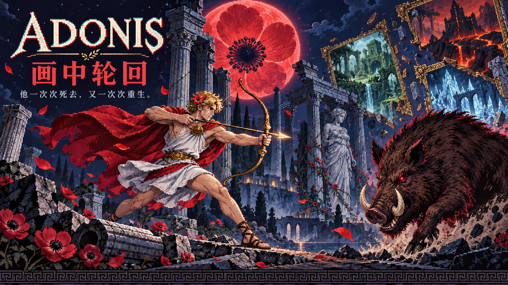

<p align="center">
  
</p>

<h1 align="center">Adonis · 画中轮回</h1>

<p align="center">
  <strong>他一次次死去，又一次次重生。</strong><br>
  穿过五层地牢，走进十种画风，去见那头野猪。<br>
  一款在浏览器里游玩的 2D 像素射击肉鸽。
</p>

<p align="center">
  
  
  
  
</p>

<p align="center">
  <a href="https://adonis-game.pages.dev/"><strong>在线试玩</strong></a>
  · <a href="https://tianmu-hackathon-group-05.test.gifshow.com/">公司 SSO 入口</a>
  · <a href="#快速开始">快速开始</a>
  · <a href="#操作指南">操作指南</a>
  · <a href="#开发文档">开发文档</a>
</p>

---

## 每次重生，走进另一幅画

阿多尼斯的血落在地上，开出了银莲花。现在，他又醒来了。

每一层地牢都会抽取一种画风：穿过异形房间与幽暗走廊，在清空敌人后推开下一扇门。收集武器、组合元素、招募伙伴，把这一局的成长带到第五层——那里等着的，永远是那头撞死他的野猪。

| 世界 | 战斗 | 相遇 |
| :---: | :---: | :---: |
| **5** 层地牢 · **10** 种画风 | **25** 把武器 · **12** 种基础法术 | **4** 位角色 · **9** 种宠物 |
| **6** 种机关 · **3** 种环境设施 | **7** 种元素 · **6** 种融合法术 | **17** 种怪物 · **11** 位 Boss |

### 这一局，打出你的风格

- **踩着节拍战斗** — 5 把近战武器各有连段与终结技；踩拍出招更强，D → SS 风格评级带来得分倍率，每次清房都有评分。
- **两把武器，多种解法** — 枪械换弹、双持开火、七元素反应，再搭配自动法术与进化。非战斗时靠近地面武器，还能在小窗里先看它的实战演示。
- **让伙伴组成流派** — 猎犬、白鸽、天鹅、小猪、奶牛、绵羊、母鸡、白兔、灵狐，配合 9 种宠物加成。集齐伙伴，还有一场特别的变化。
- **每幅画都有自己的守卫** — 10 位主题守卫，加上最终的宿敌野猪；主题专属怪物、二阶段 Boss、陷阱与掩体，让每层都有不同挑战。
- **利用环境，也挑战自己** — 引怪踏入机关，借风道、流水和传送带走位；可选挑战房考验路线与时机，不挡住主线。
- **随时回来，再闯一层** — 本机自动存档、图鉴、游戏说明与排行榜；排行榜服务不可用时，自动切换到本机成绩。

### 选择你的旅人

| 角色 | 初始武器 | 天赋 |
| --- | --- | --- |
| **阿多尼斯** · 爱神所爱的猎人 | 长弓 | 移速 +10%，暴击率 +8% |
| **骑士** · 误入画中的旅人 | 骑士手枪 | 护甲上限 +1 |
| **鲸鱼娘** · DeepSeek 海中来客 | 潮汐枪 | 弹匣容量 +20%，换弹时间 -10% |
| **程序员** · 在工位睡着的码农 | 递归键盘 | 攻击频率 +10%，暴击伤害 +30% |

### 留意脚下，也留意墙边

| 机关 | 如何应对 |
| --- | --- |
| 地刺 · 移动锯片 | 看尖头与滑槽，避开周期弹起和往返路径 |
| 墙面箭阵 | 看墙孔与箭路预警，离开发射方向 |
| 周期喷口 | 冒烟后喷出火焰或蒸汽，利用停歇时间穿过 |
| 预警落物 | 落点亮起后移开，避开落石或冰锥 |
| 交替光栅 | 观察虚线变实线的节奏，从交替空隙穿过 |

四种新机关会先给约 **1 秒预警**，再造成伤害；玩家和敌人都要小心，清房后机关停止伤害。风道、流水、传送带是另外 **3 种环境设施**，在战斗或挑战中提供轻微推动，结束后停止；不直接扣血，也不需要新增按键。

在可选的 **机关挑战房**，主动交互后，在 **20 秒内按顺序踏过 3 个标记**。受击或超时失败，每房一次机会；成功获得 **150 分**，并回复 **1 点生命和 1 格护甲**，不超过上限。可以直接跳过挑战，继续前往 Boss。

> 新机关与挑战布局用于新开的冒险；已有存档保留原来的地牢布局，直到这一局结束。

## 快速开始

**在线体验：** [进入画中轮回](https://adonis-game.pages.dev/)。原[公司 SSO 入口](https://tianmu-hackathon-group-05.test.gifshow.com/)继续保留。

**本地运行：** 使用 Node.js 22.12+（或 20.19+ 的 20.x 版本）和 npm。

```bash
git clone https://github.com/imxv/Adonis.git
cd Adonis
npm ci
npm run dev
```

打开 [http://127.0.0.1:5173](http://127.0.0.1:5173)，选择角色，即可开始冒险。

> 依赖锁文件使用公共 npm 源，无需公司网络。

| 命令 | 用途 |
| --- | --- |
| `npm run dev` | 启动开发服务器 |
| `npm run typecheck` | 检查 TypeScript 类型 |
| `npm run build` | 类型检查并构建，产物位于 `dist/` |
| `npm run preview` | 在 `http://127.0.0.1:4173` 预览构建产物 |

游戏主体可以作为静态网页部署；全服排行榜需要配套服务，本地运行时可使用本机排行榜。

## 操作指南

### 键鼠

| 按键 | 作用 |
| --- | --- |
| **W A S D** | 移动 |
| **鼠标 / 左键** | 瞄准 / 攻击；近战踩拍出招更强 |
| **空格 / Shift** | 冲刺，期间无敌；近战踩拍冲刺可触发冲击波 |
| **Q / 滚轮** | 切换武器 |
| **R** | 换弹，弹匣打空也会自动换弹 |
| **E / 右键** | 双持，两把枪同时开火 |
| **F** | 开箱、开启金色升级水晶、拾取武器、领取台上宝物、开始可选挑战 |
| **G** | 切换自动射击 |
| **Esc** | 暂停；在三选一面板中跳过奖励 |

### 手机与触屏

左摇杆移动，按住右摇杆攻击并拖动瞄准；冲刺、交互、换枪、换弹、双持和暂停使用屏幕按钮。

点击主页的「开始冒险」或「继续游戏」时，会尝试进入全屏并切换横屏。浏览器不支持时会提示转动手机，也可以选择 **「竖屏继续」**。横屏时操作区分布在两侧，竖屏时位于画面下方；切到后台会暂停并释放摇杆输入。

<details>
<summary><strong>拾取、换枪与武器试用</strong></summary>

- **经验宝石、红心**：靠近自动吸取。
- **元素结晶**：缺护甲时靠近自动收取，每颗最多恢复 1 格普通护甲；共用 2 秒收取冷却，满甲时保留到过期。共用 3 秒生成冷却，地上最多 3 颗，每颗保留 12 秒。地面不显示结晶名称；金色升级水晶仍通过 F 开启。
- **武器与箱子**：每个武器箱只开出一把武器，悬浮在箱子上方，按 F 拾取。已携带两把时可选择替换其中任意一把，旧武器留在地上，取消则保留原武器。
- **先试用，再决定**：非战斗时在武器旁短暂停留，小窗会演示当前角色的真实攻击效果，并显示伤害、攻速、射程和弹匣。开火、进入战斗、离开或打开面板时自动收起，不暂停游戏、不产生奖励。

</details>

## 开发文档

游戏使用 **Phaser 3.90 + TypeScript + Vite**，音乐与音效由 **Tone.js** 合成。游戏内像素角色、场景和特效由代码绘制。

| 入口 | 内容 |
| --- | --- |
| [设计草案](docs/spec.md) | 世界观、地牢结构与系统设计；部分早期数值与当前版本有差异 |
| [设计决策](docs/decisions.md) | 玩法取舍与实现思路 |
| [Cloudflare 部署](docs/cloudflare-deploy.md) | Pages 静态站点、Functions 排行榜与 D1 数据库 |
| [原服务器部署](ops/deploy/README.md) | 原 Python 服务的 GitHub main 自动部署、版本核验与排行榜服务 |
| [游戏数据](src/data/) | 角色、武器、法术、怪物与成长配置 |

<details>
<summary><strong>调试参数与自动试玩</strong></summary>

把参数加在页面地址后，例如 `http://127.0.0.1:5173/?seed=42&god=1`。

| 参数 | 作用 |
| --- | --- |
| `?seed=42&styles=castle,forest,volcano` | 指定随机种子和画风顺序 |
| `?diff=easy` / `?diff=hard` | 指定难度 |
| `?god=1` | 无敌 |
| `?room=boss` | 直接从 Boss 房开始 |
| `?weapon=rocket` | 指定初始武器 |
| `?light=0` | 关闭光照 |

开发服务器页面的控制台里可以运行 [自动试玩脚本](tools/playtest.js)：

```js
const pt = await import('/tools/playtest.js');
await pt.start();
await pt.play(600); // 自动试玩 600 帧
```

</details>

## 美术与字体

- **封面海报**：项目作者提供的宣传插画，用于 README 展示；游戏画面以实际运行效果为准。
- **游戏内美术与声音**：像素素材由代码生成，音乐与音效在运行时合成。
- **Fusion Pixel Font**：[TakWolf / Fusion Pixel Font](https://github.com/TakWolf/fusion-pixel-font)，SIL OFL 1.1；[许可证](src/assets/fonts/OFL-fusion-pixel.txt)。
- **Press Start 2P**：CodeMan38，SIL OFL 1.1，通过 `@fontsource/press-start-2p` 引入。

---

<p align="center"><em>血落处，银莲花再次盛开。</em></p>
